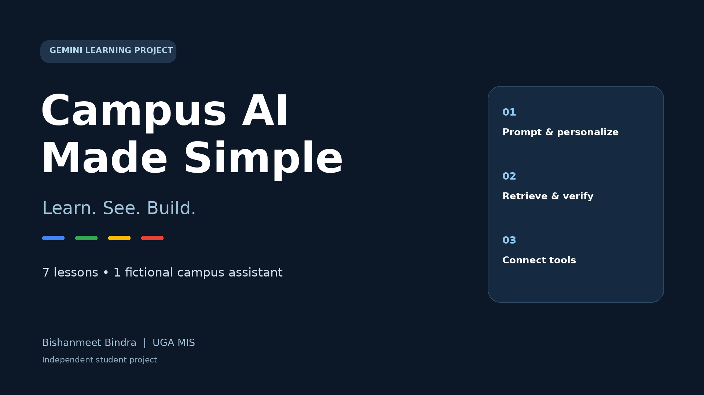

# Campus AI Made Simple

**Learn, see, build: seven small lessons using Gemini to explore how an AI assistant works.**

I’m Bishanmeet Bindra, an MIS student at UGA. Learning through workshops in Terry clubs made me interested in making technical ideas approachable for other students. This independent project turns that interest into a hands-on notebook: each lesson adds one capability to a fictional campus assistant.



## Start from scratch

Follow the [step-by-step learning guide](LEARNING_GUIDE.md) for setup, all seven lessons, practice changes, expected behavior, and troubleshooting. No previous AI experience or video recording is required.

## What you can learn

| Lesson | Try it | What it teaches |
|---|---|---|
| 1. Prompting | Compare a broad explanation with a short campus analogy | Audience and format affect the response |
| 2. Saved preferences | Reload a JSON file and change mornings to evenings | The application supplies context; the file is not model memory |
| 3. Embeddings | Compare related and unrelated sentences | Similarity helps rank meaning; it is not a confidence percentage |
| 4. Retrieval-augmented generation (RAG) | Answer from fictional records and ask for a missing room | Retrieve evidence, cite it, and acknowledge missing information |
| 5. Function calling | Calculate the exam score needed for a target grade | Let Python perform the calculation |
| 6. Model Context Protocol (MCP) | Discover and call a local library-hours tool | Connect tools through a standard protocol |
| 7. Bounded agent workflow | Combine retrieval and calculation to propose a plan | Use tools within explicit limits |

## Current evidence

Lessons **1–4 have live outputs** supplied by the project author. Lessons **5–7 are implemented and have local checks, but still need live Gemini verification**. Scripted model responses in local checks are explicitly labeled. See [EVALUATION.md](EVALUATION.md) for observed outputs and remaining checks.

The strongest demonstrated example: the assistant answered a biology exam question with the date, time, percentage, and source citation. When asked for an exam room absent from the records, it responded: “Not available in these records.” This is one successful example, not a guarantee that all future answers will be correct.

## Run the notebook

[](https://colab.research.google.com/github/Ekam-Bindra/campus-ai-made-simple/blob/main/Campus_AI_Made_Simple.ipynb)

1. Download `Campus_AI_Made_Simple.ipynb` and upload it to Google Colab, or open it locally in Jupyter.
2. Run the installation and setup cells. Enter your own Gemini API key in the hidden prompt. Do not paste a key into a public cell or commit one.
3. Run lessons in order. The notebook includes its helper files and fictional records.
4. Review both the generated answer and the tool trace. Check facts against the records.

For local use, install Python 3.10+ and run:

```bash
python -m pip install -r requirements.txt
python -m jupyterlab Campus_AI_Made_Simple.ipynb
```

The notebook uses `gemini-flash-latest` and `gemini-embedding-001`. Model availability and quotas depend on your account. If a request fails, retain the last successful output and check the error before retrying.

## Project files

- `LEARNING_GUIDE.md`: beginner walkthrough and practice exercises for all seven lessons.
- `Campus_AI_Made_Simple.ipynb`: seven interactive lessons.
- `campus_ai.py`: prompting, preference storage, embeddings, retrieval, calculator, and agent helpers.
- `campus_mcp_server.py`: local MCP server with fictional campus tools.
- `EVALUATION.md`: actual observations and pending live checks.
- `VERIFICATION.md` and `Lesson_5_6_7_Test_Report.md`: local test scope and results.
- `run_lessons_5_6_7_checks.py`: reproducible local checks using scripted API responses.
- `assets/`: cover graphic and editable SVG source.

## Scope and limitations

All records are fictional. Dates and suggested study times are examples, not UGA schedules or actual student availability. Retrieval uses a small in-memory index. Saved preferences are loaded by the application. The agent can propose a plan but cannot create calendar events. Citations and source instructions guide the model; they do not establish comprehensive accuracy or resistance to malicious instructions.

This is an independent learning project, not an official Google or UGA curriculum. No workshop delivery or ambassador selection is claimed.

## Author

[Bishanmeet Bindra on LinkedIn](https://www.linkedin.com/in/bishanmeet-bindra/) · [GitHub](https://github.com/Ekam-Bindra)
